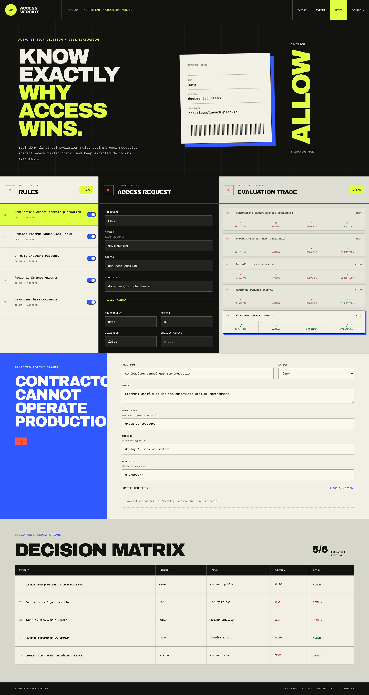

# Access Verdict

[](https://github.com/kyan9400/access-verdict/actions/workflows/ci.yml)
[](https://github.com/kyan9400/access-verdict/actions/workflows/deploy-pages.yml)
[](https://github.com/kyan9400/access-verdict/releases)
[](LICENSE)

An explainable authorization policy workbench. Model allow and deny rules, evaluate real access requests, inspect every matching check, and keep expected decisions executable as a scenario suite.

**[Open the live workbench](https://kyan9400.github.io/access-verdict/)**



## What it demonstrates

- deny-overrides semantics with an explicit default deny;
- user, group, action, and resource matching with bounded wildcards;
- request-context conditions using equality, inequality, membership, and existence;
- a full trace showing which principal, action, resource, or condition check failed;
- executable scenarios that compare expected and actual decisions after every policy edit;
- versioned local persistence plus validated JSON import and export;
- no account, backend, analytics, or policy upload.

The example policy includes contractor production restrictions, legal-hold protection, incident-response access, regional finance exports, and document ownership.

## Evaluation model

Each enabled rule is evaluated independently against the request:

```text
principal or group
        │
        ├── action pattern
        ├── resource pattern
        └── every context condition
                    │
                    ▼
              matching rule
```

If one or more deny rules match, the result is denied. Otherwise the first matching allow rule grants access. If nothing matches, the policy's default deny applies. The result includes every rule check rather than only the final answer.

Patterns are case-insensitive and support `*`, so `document:*` matches `document:read` and `docs/team/*` matches resources inside that path.

## Privacy and import safety

The workspace is stored under the versioned browser key `access-verdict:workspace:v1`. Storage access is guarded because private browsing or quota limits can make it unavailable.

Imported workspaces must use schema version 1. Rules, conditions, scenarios, context entries, arrays, and string lengths are bounded before the document reaches application state. Duplicate rule identifiers and unsupported decision values are rejected.

Access Verdict is a policy-design and testing tool. It is not an enforcement point and should not replace authorization checks in an application or gateway.

## Run locally

Requirements: Node.js 24+ and pnpm 11+.

```bash
pnpm install
pnpm dev
```

Quality gates:

```bash
pnpm lint
pnpm test
pnpm build
pnpm audit
```

The test suite covers deny precedence, wildcard matching, default deny, context operators, scenario contracts, versioned persistence, import rejection, and browser interactions.

## Architecture

The React interface is intentionally separated from the authorization engine:

```text
src/lib/evaluate.ts   pure decision engine and scenario runner
src/lib/storage.ts    bounded schema validation and persistence
src/data/sample.ts    realistic executable example
src/App.tsx           policy editor, request console, trace, matrix
```

Derived decisions and scenario results are calculated during rendering, while the stored workspace uses lazy initialization. No server state or hidden mutable policy state is involved.

## Release and rollback

Tags publish an immutable source archive and the production site bundle. GitHub Pages deploys only after lint, tests, and the production build succeed.

To roll back the public demo, rerun the Pages workflow from the previous release tag or check out that tag and run `pnpm build:pages`.

## License

[MIT](LICENSE) © Hassan Ak
